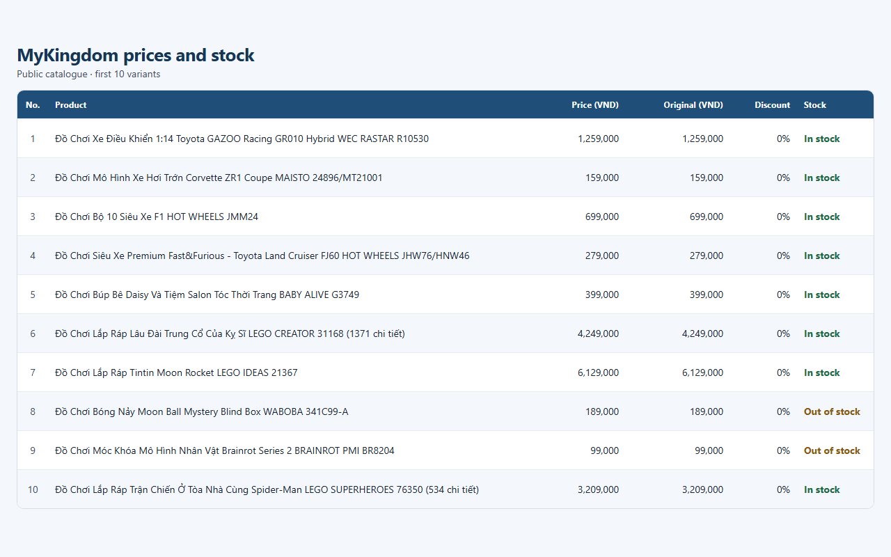

# ecommerce-price-scraper

A beginner-friendly Python tool for **toy price and promotion monitoring**. It reads the public product list of [MyKingdom Vietnam](https://www.mykingdom.com.vn), a Shopify toy store, and saves prices, discounts and stock status to CSV and Excel. Run it regularly and compare the files to see how prices and promotions change over time.



## How it works

Shopify stores publish their catalogue as structured JSON at `/products.json`. The script downloads:

```
https://www.mykingdom.com.vn/products.json?limit=250&page=N
```

for `N = 1, 2, 3, ...` and stops when `--max-pages` is reached or when the `products` list comes back empty. Each product **variant** becomes one row in the output.

## Setup

You need Python 3.10 or newer.

```powershell
# 1. Create and activate a virtual environment (Windows PowerShell)
python -m venv .venv
.venv\Scripts\Activate.ps1

# macOS / Linux:
#   python3 -m venv .venv
#   source .venv/bin/activate

# 2. Install the dependencies
pip install -r requirements.txt
```

## How to run

```powershell
python main.py                          # 3 pages (default), save to sample_output/
python main.py --max-pages 2            # only 2 pages (up to 500 products)
python main.py --max-pages 10 --out data
python main.py --help                   # show all options
```

| Option        | Default         | Meaning                                              |
|---------------|-----------------|------------------------------------------------------|
| `--max-pages` | `3`             | Maximum number of pages to download (250 products each) |
| `--out`       | `sample_output` | Folder where `products.csv` and `products.xlsx` go   |

At the end the script prints a summary: total products, % in stock, average price, top 10 brands by number of products, and the top 10 biggest discounts.

## Output

Files: `sample_output/products.csv` and `sample_output/products.xlsx`.

The Excel file has a styled header row, frozen header, filter arrows, thousands separators for VND prices and auto-fitted column widths.

| Column                 | Meaning                                                             |
|------------------------|---------------------------------------------------------------------|
| `product_id`           | Shopify product id                                                  |
| `title`                | Product name                                                        |
| `vendor`               | Brand                                                               |
| `product_type`         | Product type (can be empty)                                         |
| `tags`                 | Product tags, separated by commas                                   |
| `sku`                  | Variant SKU                                                         |
| `price_vnd`            | Current price in VND (number)                                       |
| `compare_at_price_vnd` | Original "crossed-out" price in VND (empty if none)                 |
| `discount_pct`         | `(compare_at - price) / compare_at * 100`; `0` if there is no discount |
| `available`            | `True` if the variant is in stock                                   |
| `product_url`          | `https://www.mykingdom.com.vn/products/<handle>`                    |
| `image_url`            | First product image                                                 |
| `created_at`           | When the product was created in the store                           |

## Being polite

- Custom `User-Agent` that identifies this project.
- `time.sleep(1.5)` between requests.
- 15-second timeout and up to 3 retries per page.
- Backs off if the server answers `429 Too Many Requests` (respects `Retry-After`).

## Ethics note

- **Public data only.** The script reads only the public `/products.json` catalogue, the same information shown to any visitor of the shop.
- **robots.txt is respected.** `/products.json` is allowed. The code refuses to request anything other than that page, and never touches `/cart`, `/checkout`, `/account` (or `/admin`, `/orders`).
- **No personal data.** No logins, no customer or order information, and nothing is ever added to a cart or purchased.
- Keep the request rate low, and check [robots.txt](https://www.mykingdom.com.vn/robots.txt) and the store's terms before using the data for anything beyond personal learning or price monitoring.

## Project structure

```
ecommerce-price-scraper/
├── main.py
├── requirements.txt
├── README.md
├── .gitignore
└── sample_output/
    ├── products.csv
    └── products.xlsx
```
